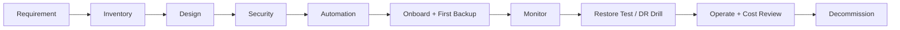

# Azure Backup Process: End to End (Har Term Samajh Ke)

Backup ka poora process 10 phases me, aur har phase ke technical terms ka simple matlab. Interview prep aur hands-on lab dono ke liye.

## Table of Contents

- [Quick Flow](#quick-flow)
- [Phase 1: Requirement Gathering](#phase-1-requirement-gathering)
- [Phase 2: Inventory](#phase-2-inventory-kya-bachana-hai)
- [Phase 3: Design](#phase-3-design)
- [Phase 4: Security](#phase-4-security)
- [Phase 5: Automation](#phase-5-automation)
- [Phase 6: Onboarding aur Pehla Backup](#phase-6-onboarding-aur-pehla-backup)
- [Phase 7: Monitoring](#phase-7-monitoring)
- [Phase 8: Restore aur Testing](#phase-8-restore-aur-testing)
- [Phase 9: Operations aur Governance](#phase-9-operations-aur-governance)
- [Phase 10: Decommission (Cleanup)](#phase-10-decommission-cleanup)
- [Lab Lessons Learned](#lab-lessons-learned)
- [Interview ke liye 60 Second Answer](#interview-ke-liye-60-second-answer)

---

## Quick Flow



**Ek line me:** Pehle RPO/RTO samjho, phir kya bachana hai dekho, vault aur policy design karo, security lagao, sab automate karo, pehla backup lo aur monitor karo, restore test se prove karo, aur ant me sahi order me cleanup karo.

---

## Phase 1: Requirement Gathering

**Kaam:**

1. App owner se poochho: kitna data khona chalega aur app kitni der band reh sakti hai.
2. Apps ko importance ke hisaab se **tier** me baanto.
3. Compliance (kitne saal data rakhna hai) pucho.

**Output:** tier-wise RPO/RTO aur retention ki list.

| Term | Matlab | Example |
|---|---|---|
| **RPO** (Recovery Point Objective) | Disaster ke time kitna **purana data** chalega. Ye batata hai backup **kitni baar** lena hai. | RPO 15 min = zyada se zyada 15 min ka data kho sakte ho. Roz raat ko backup liya aur subah disk gayi to ~10-11 ghante ka data gaya, yaani RPO 24 ghante. |
| **RTO** (Recovery Time Objective) | Disaster ke baad app kitni **jaldi wapas chalni** chahiye. Ye batata hai restore ka **tareeka**. | RTO 2 ghante = 2 ghante ke andar app live. |
| **Tier** | App ki importance ki category. | Payment system Tier-0, internal wiki Tier-2. Sab ko same protection dena mehnga padta hai. |
| **Compliance / Retention requirement** | Kanoon ya company rules jo batate hain backup kitne din rakhna hai. | "Finance data 7 saal rakhna hai." |
| **Data residency** | Data kis desh/region ke bahar nahi ja sakta. | Backup ki location isse decide hoti hai. |

---

## Phase 2: Inventory (Kya Bachana Hai)

**Kaam:**

1. Saare workloads ki list banao: VM, database, files.
2. Har ek ko **stateful** ya **stateless** mark karo.
3. Dependencies likho (app ke saath kya-kya chahiye).

**Output:** protect-list with method (backup ya redeploy).

| Term | Matlab | Example |
|---|---|---|
| **Workload** | Wo cheez jisko protect karna hai. | VM, database, file share, blob, AKS cluster |
| **Stateful** | Jisme **data jama hota hai**. Kho gaya to wapas nahi banta, isliye pakka backup chahiye. | Database, file server |
| **Stateless** | Jisme sirf code/config hai, data nahi. Redeploy karke dobara bana sakte ho. | Nginx frontend |
| **IaC** (Infrastructure as Code) | Infrastructure ko code me likhna taki ek command se dobara ban jaye. | Terraform |
| **Dependency** | Wo cheezein jinke bina app nahi chalegi. | Key Vault (secrets), DNS, certificates, config |
| **Trusted Launch VM** | Secure boot aur vTPM wala VM type (naye portal me default). Isko **Enhanced policy** chahiye. | Lab me Standard policy isi wajah se fail hui thi. |

> **Dhyan rakho:** Sirf VM bachaya aur secrets chale gaye to restore ke baad app start nahi hogi.

---

## Phase 3: Design

**Kaam:** Vault type, vault layout, redundancy, policy, DB backup aur DR ka tareeka decide karo.

### Vault aur Policy

| Term | Matlab |
|---|---|
| **Recovery Services Vault (RSV)** | Backup ka **locker/tijori**. VM, SQL in VM, Azure Files isme jate hain. |
| **Backup Vault** | RSV jaisa hi, par naye workloads ke liye (Disk, Blob, PostgreSQL, AKS). |
| **Recovery point** | Kisi khaas time ki **restore karne layak copy**. Jaise "4 Nov 2:13 PM ka backup". |
| **Backup policy** | **Rule-book**: backup kab hoga, kitni baar, aur kitne din rakhna hai. |
| **Instant restore (snapshot tier)** | Backup ke turant baad ka local snapshot jo VM ke paas rehta hai. Restore **tez** hota hai kyunki data vault se nahi kheenchna padta. |
| **GFS** (Grandfather-Father-Son) | Daily kuch din, weekly kuch hafte, monthly kuch mahine, yearly kuch saal rakhna. Purane data ki copy bhi rehti hai aur storage bhi kam badhta hai. |

### Standard vs Enhanced Policy

| | Standard | Enhanced |
|---|---|---|
| Frequency | Din me ek baar | Din me kai baar (jaise har 4 ghante) |
| Instant restore | Up to 5 din | Up to 30 din |
| Trusted Launch VM | Support nahi | Support hai |
| Cost | Kam | Snapshot cost thoda zyada |

> Enhanced policy ek baar lagane ke baad Standard me wapas nahi ja sakte.

### Redundancy

| Option | Matlab | Kab use karein |
|---|---|---|
| **LRS** | Ek hi datacenter me 3 copies | Dev/test, sasta |
| **ZRS** | Ek region ke alag zones me copies | Zone failure se bachav |
| **GRS** | Dusre (paired) region me bhi copy | Prod |
| **GRS + CRR** | Secondary region me **restore** bhi kar sakte ho | Prod aur DR drill |
| **Paired region** | Azure ke fix jode, jaise **Central India ↔ South India** | |

> **Zaroori:** Redundancy ki setting **pehla item protect karne se pehle** hi badal sakte ho. Bina CRR ke secondary copy sirf Microsoft ke failover me kaam aati hai.

### Consistency Types

| Type | Matlab |
|---|---|
| **Application-consistent** | App ki memory ka data aur pending writes pehle disk par flush karke backup (Windows me VSS). Sabse safe. |
| **File-system consistent** | Disk ki files theek, par app ki memory ka data nahi (Linux ka default). |
| **Crash-consistent** | Jaise achanak bijli gayi. Data milta hai par app ko recover karna pad sakta hai. |

### Database aur DR ke Terms

| Term | Matlab |
|---|---|
| **PITR** (Point-in-Time Restore) | Database ko **kisi bhi second par** wapas le jana. Continuous log backup se hota hai. 15 min jaise tight RPO isi se aata hai. |
| **LTR** (Long-Term Retention) | Database backup ko **saalon tak** rakhna (compliance ke liye). |
| **ASR** (Azure Site Recovery) | VM ko **dusre region me lagataar copy** karta rehta hai. Region gir jaye to wahan start karo. |
| **Read replica** | Database ki dusre region me **live copy**. Disaster me **promote** karke primary banate hain. |
| **DR** (Disaster Recovery) | Poora region gir jaye to dusre region me app chalu karna. |

> **Backup aur DR alag hain.** Backup = purani copy wapas laana. DR = app dusri jagah chalu karna. ASR corruption/delete bhi replicate kar deta hai, isliye dono chahiye.

> **Key point:** 15 min jaise tight RPO VM backup se nahi aata. Wo database layer (PITR, replica) se aata hai.

---

## Phase 4: Security

**Kaam:** Ransomware aur insider threat se backup ko bachana.

| Term | Matlab |
|---|---|
| **Soft delete** | Backup delete karne par data **turant nahi mitta**, 14 din tak wapas laya ja sakta hai. Lab me ye Always-on tha, isliye vault turant delete nahi hua. |
| **Immutable vault** | Retention khatam hone se pehle recovery points ko **koi delete nahi kar sakta**, admin bhi nahi. |
| **MUA** (Multi-User Authorization) | Critical kaam (jaise backup delete) ke liye **doosre vyakti ka approval**. |
| **Resource Guard** | MUA ka approval wala resource. Alag subscription/tenant me rakhte hain taki hacked admin akela kuch na kar paye. |
| **RBAC** | Har kisi ko sirf utna access jitna zaroori ho (**least privilege**). Jaise Backup Operator vs Contributor. |
| **PIM** (Privileged Identity Management) | Admin access **thodi der ke liye** milta hai, hamesha nahi. |
| **CMK** (Customer-Managed Key) | Encryption ki chabi Microsoft ki jagah **apni Key Vault** me. Compliance ke liye. |
| **Private Endpoint** | Vault tak traffic internet se nahi, **private network** se jata hai. |
| **Ransomware** | Hacker data lock karke paisa maangta hai, aur aksar pehle backups delete karta hai. Upar ke features isi se bachate hain. |

---

## Phase 5: Automation

**Kaam:** Sab kuch code aur policy se karo, manual nahi.

| Term | Matlab |
|---|---|
| **Terraform / Bicep** | Infrastructure ko code me likhne ke tools. Vault, policy, VM protection sab code se, same aur galti-rahit. |
| **Azure Policy (DeployIfNotExists)** | Rule jo bolta hai "jis VM par backup nahi hai uspe **apne aap laga do**". Naya VM bana aur bhool gaye, tab bhi backup lag jata hai. |
| **Tag** | VM par lage label (jaise `env=prod`). Policy tag dekhke decide karti hai kaunsi policy lagni hai. |
| **Pipeline** (Azure DevOps) | Code se infra apne aap deploy karne wala process. |

---

## Phase 6: Onboarding aur Pehla Backup

**Kaam:**

1. Vault banao aur redundancy set karo.
2. Policy attach karke VM/DB enable karo.
3. **Backup now** se pehla backup chalao.
4. Job status verify karo.

| Term | Matlab |
|---|---|
| **Protected item / Backup item** | Wo VM/DB jo vault me protect ho rahi hai. |
| **Backup now** (on-demand backup) | Schedule ka wait kiye bina **abhi** backup chalana. |
| **Full vs Incremental** | Pehla backup **full** (poora data), baad ke **incremental** (sirf jo badla). Isliye pehla lamba (lab me ~27 min), baad ke tez. |
| **VMSnapshot extension** | VM ke andar install hone wala chhota agent jo snapshot lene me madad karta hai. Backup enable karne par apne aap lagta hai. |

**Backup job ke 3 sub tasks:**

1. **Take Snapshot**: VM ka snapshot (isse instant restore point banta hai)
2. **Transfer data to vault**: snapshot ka data vault me bhejna (sabse lamba)
3. **Validate Backup**: check ki sab sahi hai

---

## Phase 7: Monitoring

| Term | Matlab |
|---|---|
| **Business Continuity Center** | Ek dashboard jahan saare backup/DR ka status dikhta hai. |
| **Backup Reports** (Log Analytics) | Backup ka data log store me jata hai, usse reports aur queries banti hain. |
| **Azure Monitor alert** | Backup fail ho to **email/Teams/ticket** aa jaye. |
| **ITSM** | Company ka ticketing system (jaise ServiceNow). Alert se ticket ban sakta hai. |

---

## Phase 8: Restore aur Testing

### Restore scenarios

| Situation | Restore tareeka |
|---|---|
| Ek file delete hui | **File Recovery** |
| VM corrupt | Restore VM / Restore disks / Replace existing |
| DB me galat data | **PITR** (naya server) |
| Region down | DR (ASR / replica promote / CRR) |
| Ransomware | Clean recovery point (immutable), isolated environment me |

### Terms

| Term | Matlab |
|---|---|
| **File Recovery** | Poora VM restore kiye bina **sirf ek file** nikalna. Recovery point ko VM me mount karte hain, file copy karte hain, phir unmount. |
| **Mount / Unmount** | Mount = recovery point ki disk VM se jodna. **Unmount = jodna band karna.** |
| **SAS** (Shared Access Signature) | Azure me temporary access link. File Recovery ke time disk restore point par khulta hai, Unmount par band hona chahiye. |
| **DR drill / test failover** | Naqli disaster chalake dekhna ki DR kaam karta hai ya nahi, bina production ko chhue. |

> **Zaroori:** File Recovery ke baad **Unmount Disks** zaroor karo. Nahi kiya to disk par SAS access khula reh jata hai aur baad me snapshot delete nahi hota.

> **"Untested backup is no backup."** Regular restore test aur DR drill karo, aur drill me **asli RPO/RTO measure** karke document karo.

---

## Phase 9: Operations aur Governance

| Term | Matlab |
|---|---|
| **RACI** | Kaun **R**esponsible, **A**ccountable, **C**onsulted, **I**nformed hai. Kaun restore approve karega, kaun alert dekhega. |
| **Runbook** | Disaster ke time step-by-step likhi guide jise koi bhi follow kar sake. |
| **Selective disk backup** | VM ki sirf zaroori disks ka backup (cost bachane ke liye). |
| **Cost drivers** | Protected instance fee + backup storage + snapshot storage + GRS/CRR ka extra. |

**Cost kam karne ke tareeke:** non-prod me LRS aur chhoti retention, selective disk backup, unused items hatana, stateless VM ko backup ki jagah IaC se redeploy.

---

## Phase 10: Decommission (Cleanup)

**Sahi order:**

1. **Stop backup + Delete backup data**, job **Completed** hone do.
2. Phir resource group delete karo.
3. Soft delete ke **14 din baad** vault delete karo.
4. `AzureBackupRG_...` ko manually mat chhedo (Azure Backup service ise manage karti hai).

| Term | Matlab |
|---|---|
| **Orphan resource** | Wo resource jiska owner (jaise vault) delete ho gaya par wo bach gaya. Service ab use saaf nahi kar sakti, to manually hatana padta hai. Lab me snapshot yahi ban gaya tha. |

---

## Lab Lessons Learned

| Problem | Wajah | Fix |
|---|---|---|
| Standard policy fail hui | VM **Trusted Launch** hai | **Enhanced policy** use ki |
| Soft delete band nahi hua | Naye portal me **Always-on** | Skip kiya, vault 14 din baad delete |
| Vault turant delete nahi hua | Soft-deleted data 14 din rehta hai | 14 din baad delete |
| `sudo ./recover.py` fail hua | Ubuntu 22.04 me `python` nahi, `python3` hota hai | `sudo python3 recover.py` |
| Snapshot aur RG delete nahi hue | File Recovery ke baad **Unmount nahi kiya**, disk restore point par SAS access khula raha | `EndGetAccess` se revoke karke delete kiya |
| Orphan snapshot bacha | Backup data delete hone se pehle RG delete kiya | Pehle Stop backup + Delete data, phir RG |

**SAS revoke aur cleanup ke commands (Cloud Shell):**

```bash
# Disk restore point par khula SAS access band karta hai
az rest --method post --url "https://management.azure.com/subscriptions/<SUB_ID>/resourceGroups/<BACKUP_RG>/providers/Microsoft.Compute/restorePointCollections/<COLLECTION>/restorePoints/<RESTORE_POINT>/diskRestorePoints/<DISK_RP>/endGetAccess?api-version=2024-03-02"

# Restore point delete karta hai
az restore-point delete -g <BACKUP_RG> --collection-name <COLLECTION> --name <RESTORE_POINT> --yes

# Khali collection delete karta hai
az restore-point collection delete -g <BACKUP_RG> --collection-name <COLLECTION> --yes

# Resource group delete karta hai
az group delete -n <BACKUP_RG> --yes --no-wait
```

---

## Interview ke liye 60 Second Answer

> "Backup design se pehle main business requirement dekhta hoon, yaani RPO, RTO aur app criticality, kyunki wahi frequency aur technique decide karte hain. Phir kya protect karna hai: workload type, stateful ya stateless, aur dependencies jaise Key Vault. Phir retention aur compliance, redundancy aur region (prod me GRS plus CRR), security (soft delete, immutable vault, MUA, RBAC), aur cost. Sab Terraform aur Azure Policy se automate karta hoon, monitoring alerts se, aur regular restore drill se prove karta hoon ki design kaam karta hai. Backup aur DR dono rakhta hoon kyunki ASR corruption bhi replicate kar deta hai."

**Yaad rakhne ka shortcut:** **R-W-R-S-C-R-A**
**R**equirement, **W**orkload, **R**etention, **S**ecurity, **C**ost, **R**estore scenarios, **A**utomation/testing.